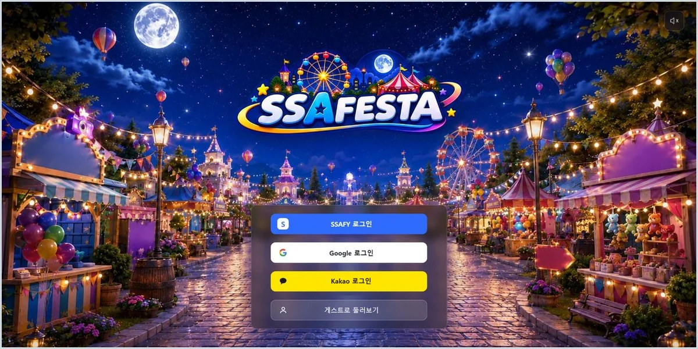
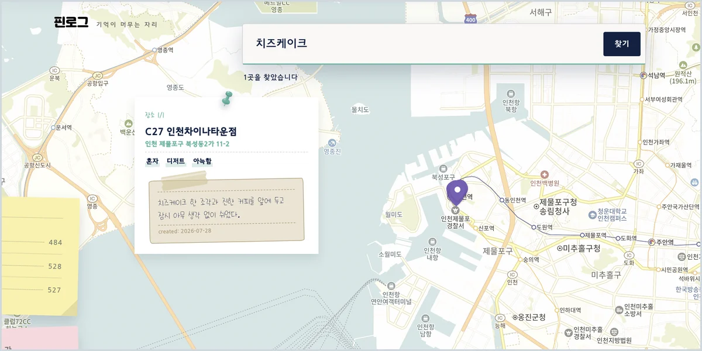
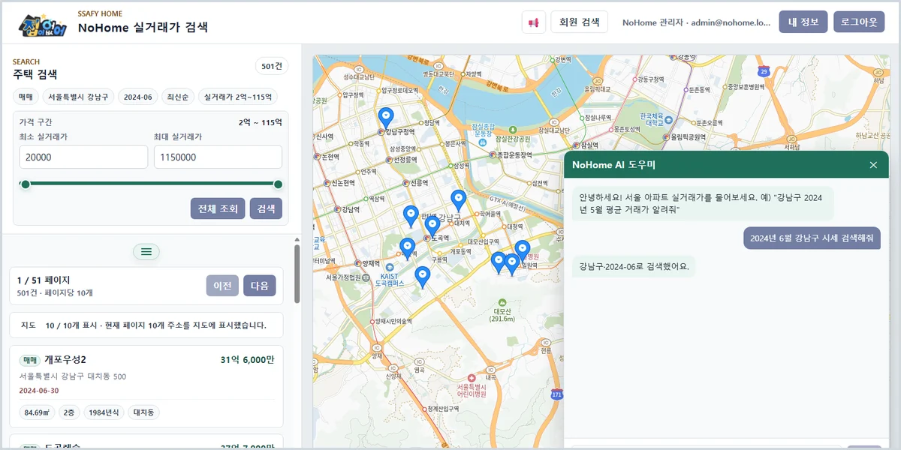
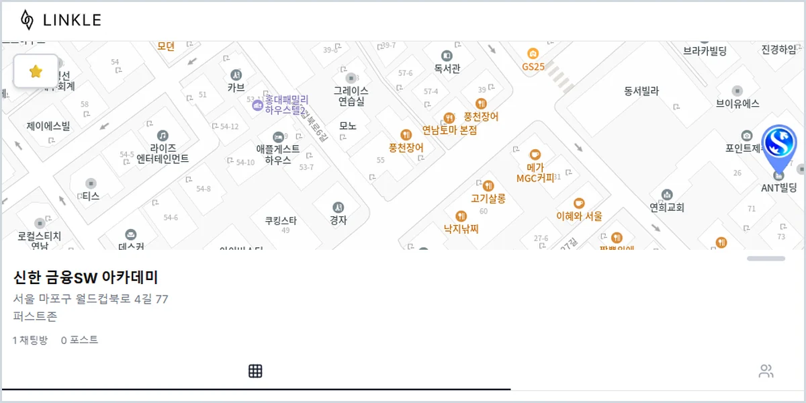

# 이정헌 (Lee Jeongheon)

Web Platforms · AI Applications · Developer Tools

팀 프로젝트에서 웹 플랫폼 통합, AI 서버, 인증과 배포를 맡았고 AI 코딩 에이전트용 개발 도구 두 개를 npm에 배포했습니다. 프로젝트별 담당 범위와 근거 코드는 각 개인 기여 기록에 정리했습니다.

[Projects](#selected-projects) · [Engineering](#engineering) · [Developer Tools](#published-developer-tools) · [Background](#earlier-work--background)

## Selected Projects

<table>
<tr>
<td width="50%" valign="top">
 
<b><a href="projects/ssafesta.md">SSAFESTA</a></b> · Frontend Main · 6인 
React·Unity 통합, 통합 검증과 Production 승격
</td>
<td width="50%" valign="top">
 
<b><a href="projects/pinlog.md">PinLog</a></b> · AI 파트 · 6인 
FastAPI AI 파이프라인과 자연어 검색 품질 개선
</td>
</tr>
</table>

<table>
<tr>
<td width="50%" valign="top">
 
<b><a href="projects/nohome.md">NoHome</a></b> · 팀장 · 3인 · 최우수상(팀) 
Tool Calling 기반 AI 어시스턴트와 개인 배포
</td>
<td width="50%" valign="top">
 
<b><a href="projects/linkle.md">LINKLE</a></b> · 팀장 · 5인 
FE·BE 인증 구조와 Docker·Nginx 배포
</td>
</tr>
</table>

원본 저장소: [SSAFESTA](https://github.com/mingleland/ssafesta) · [PinLog](https://github.com/Team-PinLog/PinLog) · [NoHome](https://github.com/repechage-team/no-home-backend) · [LINKLE](https://github.com/LINKLE-2025/LINKLE_Frontend)

## Engineering

**Stack**

- **Web & Integration** SSAFESTA · LINKLE React · TypeScript · Unity WebGL 연동 · WebSocket(STOMP)
- **Backend & AI** PinLog · NoHome · LINKLE Java · Spring Boot · Python · FastAPI · PostgreSQL · pgvector · Redis
- **CI/CD & Infra** SSAFESTA · NoHome · LINKLE AWS EC2 · Jenkins · Docker · Nginx · OCI ARM
- **Developer Tools** ASC · JAM TypeScript · MCP · npm

**Problem Solving**

1. **CI/CD 구조 재설계** · [SSAFESTA](projects/ssafesta.md#4-engineering-decisions)
   - AWS EC2 Jenkins 파이프라인을 Demo 검증 산출물 그대로 Production에 올리는 승격 구조로 재설계, main 승격 11건
   - 변경 컴포넌트만 검증하도록 바꿔 CI 설정만 고친 MR 12분 → 35초
2. **시스템 경계 문제** · [SSAFESTA](projects/ssafesta.md#4-engineering-decisions)
   - React·Unity 사이 ESC 이중 입력을 Unity 상태 snapshot과 명시 명령으로 해결
   - 문서 처리 전면 실패를 재현해 BE·AI 계약 불일치를 규명, 양쪽 수정
3. **측정 기반 판단** · [PinLog](projects/pinlog.md#4-engineering-decisions)
   - 임베딩·프롬프트·다수결 변경을 측정해 근거 없는 변경 기각
   - 짧은 질의 검색 실패를 문자열 병합 신호로 해결
4. **구조 개선과 운영** · [NoHome](projects/nohome.md#4-engineering-decisions) · [LINKLE](projects/linkle.md#4-engineering-decisions)
   - NoHome: 챗봇·에이전트 두 경로를 Tool Calling 단일 엔드포인트로 통합
   - LINKLE: 401 자동 갱신의 루프 위험을 탭 복귀 시 갱신으로 전환

## Published Developer Tools

- **[ASC](https://github.com/colosair/asc)** · Agent Session Control · `v0.10.2` · [npm](https://www.npmjs.com/package/@asc-agent/runtime) 
  AI 코딩 에이전트 세션의 목표·쓰기 경계·승인 조건을 계약으로 관리하는 로컬 제어 계층
- **[JAM](https://github.com/colosair/jam)** · Jira Agent MCP · `v1.8.0` · [npm](https://www.npmjs.com/package/@jam-mcp/server) 
  Jira 읽기 결과에 조회 범위를 표시하고, 쓰기는 Plan → Apply → Verify로만 실행하는 MCP 서버

## Earlier Work & Background

이전 작업 — CardGarden · teacafe_POS · DB/Spring Quiz · SQLP Tuning Mock

- **[CardGarden](https://github.com/colosair/cardgarden)** · 2025 · 팀장 
  Spring·MyBatis 기반 카드 추천 웹 서비스. 이메일 인증·3사 OAuth2, 초기 구조·배포
- **[teacafe_POS](https://github.com/colosair/teacafe_POS)** · 2025 · 개인 
  Java·JDBC로 만든 찻집 콘솔 POS 학습 프로젝트
- **[DB Quiz](https://github.com/colosair/db-quiz) · [Spring Quiz](https://github.com/colosair/spring-quiz)** · 2026 · 개인 
  과목평가 대비 모의고사 웹앱, 각 150문항
- **[SQLP Tuning Mock](https://github.com/colosair/sqlp-tuning-mock)** · 2026 · 개인 
  SQL 튜닝 창작 모의문제 240문항, CC BY 4.0

**Education**

- SSAFY 15기 — 교육 중 · 2026.01.07 ~ 현재
- 신한DS 금융SW 아카데미 5기 — 수료 · 976시간 · 2025.04.01 ~ 2025.10.01

**Awards**

- SSAFY 1학기 프로젝트 최우수상 — 팀, NoHome · 2026.06
- SSAFY 1학기 성적우수상 — 개인, 종합성적 반 3등 · 2026.06

**Certifications**

- 정보처리기사 · SQLD · ADsP
