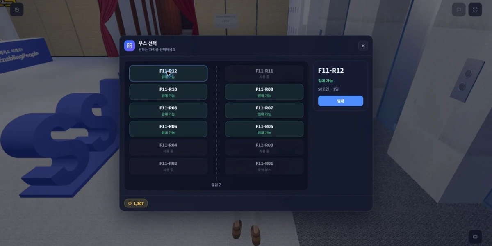
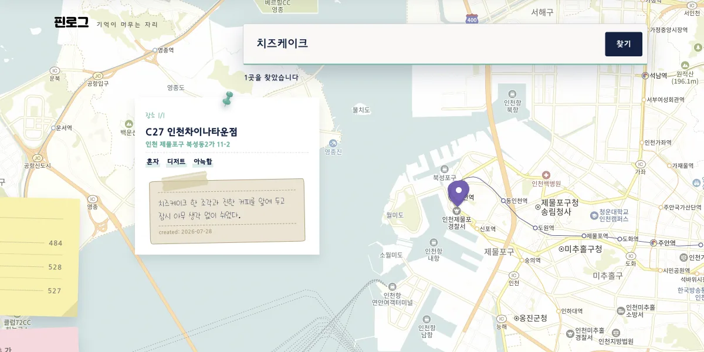
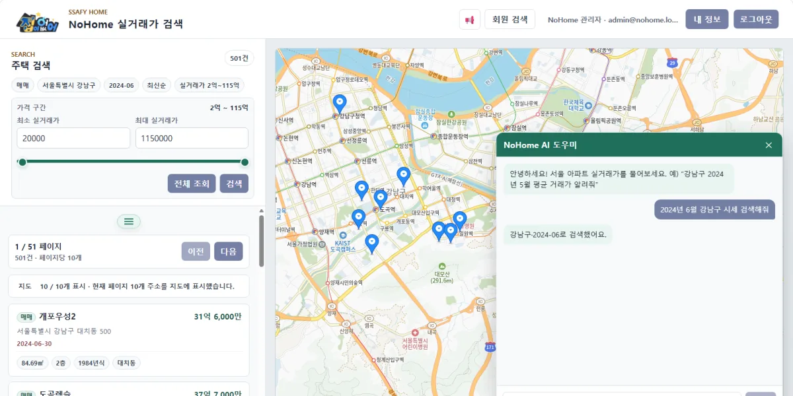
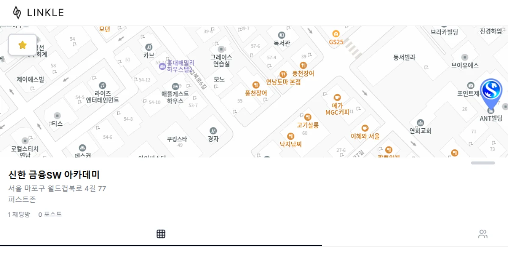

# 이정헌 (Lee Jeongheon)

Web Platforms · AI Applications · Developer Tools

팀 프로젝트에서 맡은 개발 영역과 직접 배포한 개발자 도구를 정리했습니다. 프로젝트마다 개인 기여 기록에서 담당 범위와 근거가 되는 코드·PR을 확인할 수 있습니다.

[Team Projects](#selected-team-projects) · [Developer Tools](#published-developer-tools) · [Earlier Work & Background](#earlier-work--background)

## Selected Team Projects

### SSAFESTA

2026.08 – 09 · Frontend Main · 6인 팀

Unity WebGL 월드 위에 React 오버레이를 얹은 메타버스 부스·전시 서비스입니다.

- React 프론트엔드 공통 구조와 Unity Host·Bridge 계층 설계·구현
- FE·BE·Unity 통합 검증, Demo에서 검증한 산출물의 Production 승격

[개인 기여 기록](projects/ssafesta.md) · [원본 저장소](https://github.com/mingleland/ssafesta)

### PinLog

2026.07 – 08 · AI 파트 담당 · 6인 팀

장소를 방문 이유와 경험과 함께 기록하고, 자연어로 다시 찾는 장소 아카이빙 서비스입니다.

- FastAPI AI 서버의 비동기 처리 파이프라인과 상태 전이
- 자연어 검색 4신호 고도화, 측정으로 정한 채택·기각

[개인 기여 기록](projects/pinlog.md) · [원본 저장소](https://github.com/Team-PinLog/PinLog)

### NoHome

2026.06 · 팀장·AI 어시스턴트 · 3인 팀 · 1학기 프로젝트 최우수상(팀)

서울 아파트 실거래가 조회에 AI 어시스턴트를 더한 웹 서비스입니다.

- Tool Calling으로 조회 답변과 화면 조작을 나눈 AI 어시스턴트 설계·구현
- 팀 종료 후 개인 고도화로 OCI ARM 서버에 Docker Compose·HTTPS 배포

[개인 기여 기록](projects/nohome.md) · [팀 원본](https://github.com/repechage-team/no-home-backend) · [개인 고도화](https://github.com/no-home-project/no-home-docs)

### LINKLE

2025.08 – 09 · 팀장·인증·배포 · 5인 팀

지도 위 장소에 사진과 메모를 남기고, 같은 장소에 관심 있는 사람과 연결되는 지역 SNS입니다.

- Spring Boot·React 양단 인증: JWT·Redis·HttpOnly 쿠키, 탭 복귀 시 토큰 갱신
- 로컬 HTTPS·CORS 구성과 Docker·Nginx 배포

[개인 기여 기록](projects/linkle.md) · [Frontend](https://github.com/LINKLE-2025/LINKLE_Frontend) · [Backend](https://github.com/LINKLE-2025/LINKLE_Backend)

## Published Developer Tools

직접 설계·구현하고 npm에 배포한 도구입니다.

### ASC — Agent Session Control

AI 코딩 에이전트 세션마다 목표·쓰기 경계·승인 조건을 계약으로 두고, 실제 경계에서만 사람의 승인을 거치게 하는 로컬 제어 계층입니다.

`v0.10.2` · [소스·README](https://github.com/colosair/asc) · [npm](https://www.npmjs.com/package/@asc-agent/runtime)

### JAM — Jira Agent MCP

Jira 읽기 결과에 조회 범위를 함께 알리고, 쓰기는 Plan → Apply → Verify 절차로만 실행하는 MCP 서버입니다.

`v1.8.0` · [소스·README](https://github.com/colosair/jam) · [npm](https://www.npmjs.com/package/@jam-mcp/server)

## Earlier Work & Background

이전 작업 — CardGarden · teacafe_POS · DB/Spring Quiz · SQLP Tuning Mock

- [CardGarden](https://github.com/colosair/cardgarden) · 2025 — Spring·MyBatis 기반 카드 추천 웹 서비스. 팀장, 이메일 인증·3사 OAuth2, 초기 구조·배포
- [teacafe_POS](https://github.com/colosair/teacafe_POS) · 2025 — Java·JDBC로 만든 찻집 콘솔 POS, 개인 학습 프로젝트
- [DB Quiz](https://github.com/colosair/db-quiz) · [Spring Quiz](https://github.com/colosair/spring-quiz) · 2026 — 과목평가 대비 모의고사 웹앱, 각 150문항
- [SQLP Tuning Mock](https://github.com/colosair/sqlp-tuning-mock) · 2026 — SQL 튜닝 창작 모의문제 240문항, CC BY 4.0

**Education**

- SSAFY 15기 — 1학기 과정 이수 · 925시간 (2026.01 – 06)
- 신한DS 금융SW 아카데미 5기 — 수료 · 976시간 (2025.04 – 10)

**Awards**

- SSAFY 1학기 프로젝트 최우수상 — 팀, NoHome (2026.06)
- SSAFY 1학기 성적우수상 — 개인, 종합성적 반 3등 (2026.06)

**Certifications**

정보처리기사 · SQLD · ADsP

