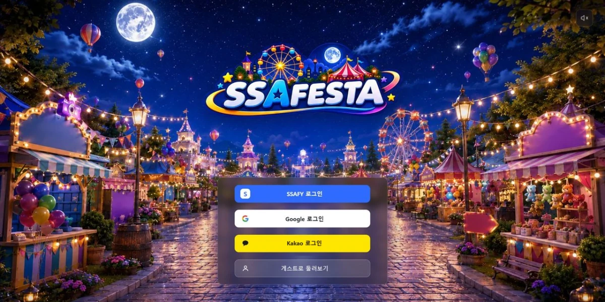

## A. 2x2 inline gallery

1. **SSAFESTA** — React·Unity 통합, 통합 검증과 Production 승격
2. **PinLog** — FastAPI AI 처리 파이프라인과 자연어 검색 품질 개선
3. **NoHome** — Tool Calling 기반 AI 어시스턴트, 개인 고도화 배포
4. **LINKLE** — FE·BE 인증 구조와 Docker·Nginx 배포

## B. media object (float)

### SSAFESTA
2026.08 – 09 · Frontend Main · 6인 팀
React·Unity 통합, 통합 검증과 Production 승격
[개인 기여 기록](projects/ssafesta.md) · [원본 저장소](https://github.com)

 

### PinLog
2026.08 – 09 · Frontend Main · 6인 팀
React·Unity 통합, 통합 검증과 Production 승격
[개인 기여 기록](projects/pinlog.md) · [원본 저장소](https://github.com)

 

### NoHome
2026.08 – 09 · Frontend Main · 6인 팀
React·Unity 통합, 통합 검증과 Production 승격
[개인 기여 기록](projects/nohome.md) · [원본 저장소](https://github.com)

 

### LINKLE
2026.08 – 09 · Frontend Main · 6인 팀
React·Unity 통합, 통합 검증과 Production 승격
[개인 기여 기록](projects/linkle.md) · [원본 저장소](https://github.com)

 

