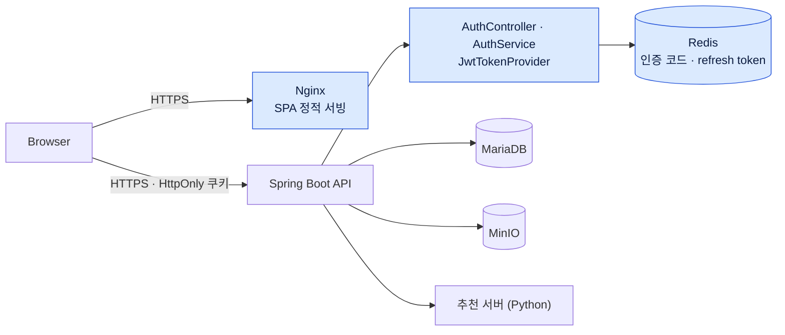

# LINKLE — 개인 기여 기록

> 팀 프로젝트 저장소는 [LINKLE-2025](https://github.com/LINKLE-2025) 조직에 있습니다.
> 이 문서는 그중 본인이 맡은 인증 서브시스템(프론트엔드·백엔드)과 배포 구성만 정리합니다.

## 1. Overview

| 항목 | 내용 |
|---|---|
| 프로젝트 | LINKLE — 지도 위 장소에 사진·메모를 남기고 같은 장소에 관심 있는 사람과 연결되는 지역 SNS |
| 기간 | 2025-08 ~ 2025-09 (본인 커밋 집중 구간 2025-09-01 ~ 09-30) |
| 팀 | 신한DS 금융SW 아카데미 5기 팀 프로젝트. 5인으로 시작해 진행 중 1명 이탈 |
| 결과물 | React·TypeScript PWA, Spring Boot API, Python 추천 서버, Docker·Nginx 배포 |
| 본인 역할 | 팀장, 인증(프론트엔드·백엔드) 담당, 프론트엔드 공통 레이아웃, 배포 |
| 주요 기술 | Spring Boot, Spring Security, JWT(jjwt), Redis, BCrypt, React, TypeScript, Axios, Zustand, Docker 멀티스테이지, Nginx |

지도·포스팅·채팅·추천·결제 기능은 다른 팀원의 작업입니다. 본인은 인증 관련 파일과 배포 파일을 주로 작성했습니다.

## 2. Project Architecture

파란색은 본인이 설계·구현한 인증 경로와 배포 구성입니다. 프론트엔드에서는 API 클라이언트·인증 상태·토큰 갱신 훅을 맡았습니다.

## 3. My Contributions

### 3.1 백엔드 인증 — 직접 설계·구현

- **수행** 회원가입은 이메일·닉네임 중복 확인 → `SecureRandom` 6자리 인증 코드 메일 발송·저장·검증 → BCrypt 해시 저장 순서로 만들었습니다([2c29afd](https://github.com/LINKLE-2025/LINKLE_Backend/commit/2c29afd)). 로그인 시 JWT access·refresh를 발급하고, refresh는 Redis에 `RT:{userId}` 키로 TTL과 함께 저장합니다([7538d9a](https://github.com/LINKLE-2025/LINKLE_Backend/commit/7538d9a)). 토큰은 응답 본문이 아니라 `HttpOnly`·`Secure`·`SameSite=None` 쿠키로 내려보냅니다.
- **재발급과 로그아웃** `/auth/refresh`는 쿠키의 refresh token을 Redis 저장값과 대조한 뒤 access token을 새로 발급합니다. 로그아웃은 쿠키 만료와 Redis 삭제를 함께 수행합니다.
- **근거** [AuthController.java](https://github.com/LINKLE-2025/LINKLE_Backend/blob/develop/src/main/java/com/linkle/controller/AuthController.java) · [AuthService.java](https://github.com/LINKLE-2025/LINKLE_Backend/blob/develop/src/main/java/com/linkle/service/AuthService.java) · [JwtTokenProvider.java](https://github.com/LINKLE-2025/LINKLE_Backend/blob/develop/src/main/java/com/linkle/util/JwtTokenProvider.java) · [RefreshTokenRepository.java](https://github.com/LINKLE-2025/LINKLE_Backend/blob/develop/src/main/java/com/linkle/repository/RefreshTokenRepository.java)

### 3.2 프론트엔드 인증 연동 — 직접 설계·구현

- **수행** 인증이 필요한 요청용 `apiClient`(`withCredentials: true`)와 로그인·회원가입·갱신용 `plainApiClient`를 분리했습니다. 로그인 상태는 `authStore`가 `/auth/me`로 동기화하고, 보호 라우트에서 비로그인 접근을 막았습니다([40480be](https://github.com/LINKLE-2025/LINKLE_Frontend/commit/40480be)).
- **토큰 갱신** 탭이 다시 보일 때 마지막 갱신 후 10분이 지났으면 refresh를 호출하는 `useFocusRefresh`를 만들었습니다.
- **근거** [apiClient.ts](https://github.com/LINKLE-2025/LINKLE_Frontend/blob/develop/src/api/apiClient.ts) · [useFocusRefresh.ts](https://github.com/LINKLE-2025/LINKLE_Frontend/blob/develop/src/hooks/useFocusRefresh.ts) · [authStore.ts](https://github.com/LINKLE-2025/LINKLE_Frontend/blob/develop/src/store/authStore.ts)

### 3.3 개발 환경과 배포 — 직접 구현

- 쿠키 인증이 로컬에서도 동작하도록 프론트엔드 HTTPS 개발 서버([7ee47a2](https://github.com/LINKLE-2025/LINKLE_Frontend/commit/7ee47a2))와 백엔드 PKCS12 인증서([26fe137](https://github.com/LINKLE-2025/LINKLE_Backend/commit/26fe137))를 구성하고, 개발용 오리진을 명시한 CORS 설정을 넣었습니다([305b91d](https://github.com/LINKLE-2025/LINKLE_Backend/commit/305b91d)).
- 백엔드는 JDK 17 빌드 → JRE 17 런타임, 프론트엔드는 Node 22 빌드 → `nginx:alpine` 정적 서빙의 멀티스테이지 Dockerfile로 배포했습니다([cb92793](https://github.com/LINKLE-2025/LINKLE_Backend/commit/cb92793) · [8d2bd7b](https://github.com/LINKLE-2025/LINKLE_Frontend/commit/8d2bd7b)). Nginx는 `try_files`로 SPA 라우팅을 처리합니다.

### 3.4 팀 운영 — 협업 및 조정

- 주제와 기술 스택 선정 근거를 정리해 팀 합의를 이끌었고, 본인이 공통 레이아웃과 개발 환경을 잡는 동안 플로우차트·ERD·API 명세를 나눠 병렬로 진행했습니다.
- 팀원 1명이 이탈한 뒤 우선순위를 다시 정하고 역할을 재배분해 인증·지도·SNS·채팅 중심으로 범위를 조정했습니다.

## 4. Engineering Decisions

### 401마다 자동 갱신하지 않고 탭 복귀 시점에만 갱신

- **문제** 처음에는 응답 인터셉터가 401을 받으면 refresh 후 원 요청을 재시도하도록 만들었습니다. refresh 자체가 실패하면 재요청 → 401 → refresh 루프가 생길 수 있고, 동시에 여러 요청이 refresh를 중복 호출했습니다.
- **검토** 진행 중인 refresh가 있으면 같은 Promise를 돌려주는 단일화 큐(`refreshQueue`)로 중복 호출을 줄이는 방법을 먼저 만들었습니다.
- **선택** 인터셉터의 자동 갱신·재시도 경로를 비활성화하고, 탭 복귀 시점에 쿨다운을 두고 갱신하는 Focus-Refresh로 바꿨습니다([0dc6a9f](https://github.com/LINKLE-2025/LINKLE_Frontend/commit/0dc6a9f)).
- **현재 코드 상태** 최종 코드에서 `refreshQueue`는 남아 있지만, 이를 호출하던 인터셉터 경로가 주석 처리되어 실제로는 쓰이지 않습니다. 동작하는 갱신 경로는 Focus-Refresh 하나입니다.

### 토큰을 응답 본문이 아니라 HttpOnly 쿠키로 전달

- **선택** 브라우저 스크립트가 토큰을 읽지 못하도록 access·refresh를 모두 `HttpOnly` 쿠키로 내렸습니다.
- **대가** `Secure`·`SameSite=None` 쿠키는 HTTPS와 정확한 CORS 오리진이 있어야 전송됩니다. 그래서 로컬 개발 환경부터 HTTPS와 오리진 목록을 맞췄습니다.

## 5. Troubleshooting

### 로그인은 성공하는데 이후 요청에 쿠키가 실리지 않았다

- **증상** 로그인 후 `/auth/me` 같은 인증 요청이 401을 받았습니다.
- **원인** `Secure`·`SameSite=None` 쿠키는 HTTPS에서만 전송되는데 개발 서버가 HTTP였습니다. 클라이언트에 `withCredentials`도 없었습니다.
- **조치** 프론트엔드·백엔드 로컬 HTTPS, `withCredentials: true`, 개발 오리진 화이트리스트를 함께 적용했습니다.

### credentials 요청의 CORS preflight가 실패했다

- **원인** 쿠키를 싣는 요청은 `Access-Control-Allow-Origin`에 와일드카드를 쓸 수 없고, 정확한 오리진과 allow-credentials가 필요합니다.
- **조치** 오리진 목록을 프로퍼티로 분리하고 credentials를 허용했습니다([305b91d](https://github.com/LINKLE-2025/LINKLE_Backend/commit/305b91d)).

## 6. Validation & Results

| 항목 | 결과 | 근거 |
|---|---|---|
| 배포 | 백엔드·프론트엔드 컨테이너 배포 (2025-09-11 커밋) | [cb92793](https://github.com/LINKLE-2025/LINKLE_Backend/commit/cb92793) · [8d2bd7b](https://github.com/LINKLE-2025/LINKLE_Frontend/commit/8d2bd7b) |
| 인증 흐름 | 회원가입(이메일 인증) → 로그인 → 쿠키 기반 `/auth/me` → 탭 복귀 갱신 → 로그아웃 경로 구현 | [AuthController.java](https://github.com/LINKLE-2025/LINKLE_Backend/blob/develop/src/main/java/com/linkle/controller/AuthController.java) |

인증 기능에 대한 자동화 테스트는 작성하지 않았고, 동작은 수동으로 확인했습니다.

## 7. Evidence

- 저장소: [LINKLE_Frontend](https://github.com/LINKLE-2025/LINKLE_Frontend) · [LINKLE_Backend](https://github.com/LINKLE-2025/LINKLE_Backend)
- 백엔드 인증: [SecurityConfig.java](https://github.com/LINKLE-2025/LINKLE_Backend/blob/develop/src/main/java/com/linkle/config/SecurityConfig.java) · [RedisConfig.java](https://github.com/LINKLE-2025/LINKLE_Backend/blob/develop/src/main/java/com/linkle/config/RedisConfig.java) · [CodeGenerator.java](https://github.com/LINKLE-2025/LINKLE_Backend/blob/develop/src/main/java/com/linkle/util/CodeGenerator.java)
- 프론트엔드 인증: [plainApiClient.ts](https://github.com/LINKLE-2025/LINKLE_Frontend/blob/develop/src/api/plainApiClient.ts) · [refreshQueue.ts](https://github.com/LINKLE-2025/LINKLE_Frontend/blob/develop/src/utils/refreshQueue.ts)
- 배포: [Backend Dockerfile](https://github.com/LINKLE-2025/LINKLE_Backend/blob/develop/Dockerfile) · [Frontend Dockerfile](https://github.com/LINKLE-2025/LINKLE_Frontend/blob/develop/Dockerfile) · [nginx.conf](https://github.com/LINKLE-2025/LINKLE_Frontend/blob/develop/nginx.conf)

### 남아 있는 보안 부채

과거 구현에 남은 문제를 그대로 적습니다.

- `SecurityConfig`가 개발 편의를 위해 `/api/**`를 모두 `permitAll`로 열어 두었고, 토큰 검증은 각 컨트롤러에서 수동으로 합니다. JWT 인증 필터로 라우트 보호를 일원화하지 않았습니다.
- CSRF 보호를 끈 상태에서 `SameSite=None` 쿠키를 사용합니다. 별도의 CSRF 방어 장치는 없습니다.
- 일부 외부 API 설정값이 환경변수로 분리되지 않고 설정 파일에 남아 있습니다.
- access token 만료 기본값은 코드에서 15분이지만, 커밋된 설정 파일이 60분으로 덮어씁니다.

