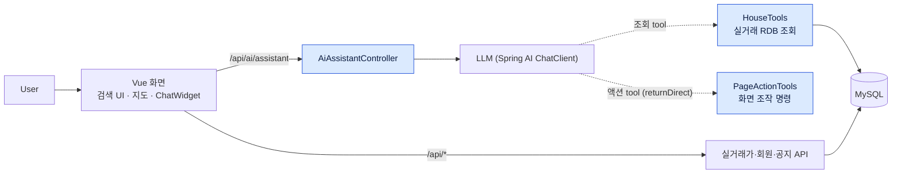
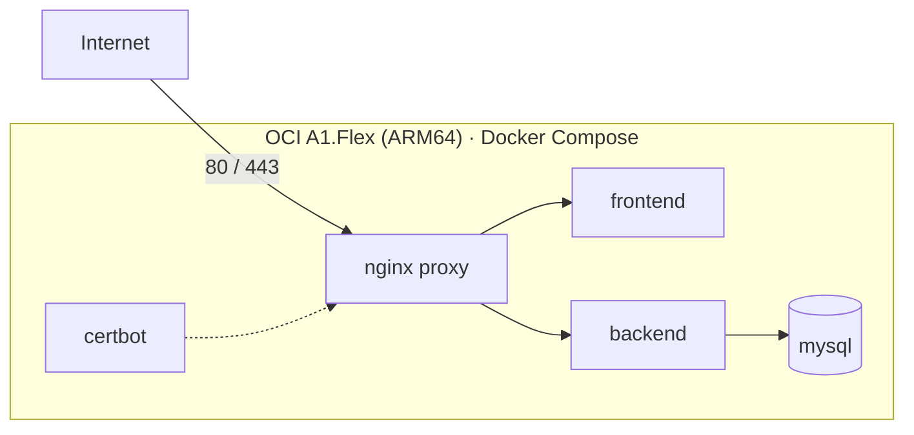

# NoHome — 개인 기여 기록

> NoHome은 두 단계로 나뉩니다. **팀 프로젝트**(2026-06-12 ~ 06-26)는 3인 팀이 함께 만든 결과물이고, **개인 고도화**(2026-06-27 ~ 07-05)는 팀 프로젝트 종료 후 본인이 별도 조직으로 옮겨 혼자 진행한 배포 작업입니다.
> 팀 원본은 [repechage-team](https://github.com/repechage-team), 개인 고도화 저장소는 [no-home-project](https://github.com/no-home-project)에 있습니다.

## 1. Overview

| 항목 | 팀 프로젝트 | 개인 고도화 |
|---|---|---|
| 기간 | 2026-06-12 ~ 2026-06-26 | 2026-06-27 ~ 2026-07-05 |
| 인원 | 3인 — 팀장·AI 어시스턴트(본인), 공공데이터·검색·성능, 회원·인증·지도 | 1인(본인) |
| 목적 | 서울 아파트 실거래가 조회와 AI 어시스턴트 | 팀 결과물을 인터넷에서 접근 가능한 서비스로 배포 |
| 결과물 | Spring Boot API, Vue 프론트엔드, 문서·발표 산출물. SSAFY 1학기 프로젝트 최우수상(팀) | 4개 저장소 이관, 환경 설정 분리, OCI ARM 서버 Docker Compose·HTTPS 배포(2026-07-04) |
| 본인 역할 | 팀장, AI 어시스턴트 백엔드·프론트엔드 담당, 회의·문서·발표 총괄 | 이관·환경 설정·배포·공개 전 보안 정리 전담 |
| 주요 기술 | Spring Boot, Spring AI(Tool Calling), MySQL, Vue, Vite, JUnit, `node --test` | Docker Compose, nginx, Let's Encrypt, OCI A1(ARM64), git filter-repo |

## 2. Project Architecture

파란색이 팀 프로젝트에서 본인이 설계·구현한 AI 어시스턴트 영역입니다(프론트엔드 `ChatWidget`과 `src/chat/*` 포함). 공공데이터 적재·검색·회원·지도 기능은 다른 팀원의 영역입니다.

개인 고도화의 배포 구성은 다음과 같습니다.

## 3. My Contributions

### 3.1 AI 어시스턴트 — 직접 설계·구현 (팀 프로젝트)

- **배경** 실거래가 검색 화면에 자연어로 질문하고, 필터 변경·페이지 이동 같은 화면 조작도 맡길 수 있는 어시스턴트가 필요했습니다.
- **책임** 백엔드 `com.ssafy.home.ai` 패키지와 프론트엔드 `ChatWidget.vue`·`src/chat/*`·`houseSearchParams.js` 전담.
- **수행** 2026-06-21 ~ 06-24에 챗봇([71877cd](https://github.com/repechage-team/no-home-backend/commit/71877cd)) → 화면 조작 에이전트([0ee61b0](https://github.com/repechage-team/no-home-backend/commit/0ee61b0) · [e1f4ba2](https://github.com/repechage-team/no-home-backend/commit/e1f4ba2)) → Tool Calling 단일 엔드포인트([a487fc6](https://github.com/repechage-team/no-home-backend/commit/a487fc6) · [cac581c](https://github.com/repechage-team/no-home-backend/commit/cac581c))로 구조를 바꿨습니다. 대화 기억은 세션 단위 메모리로만 유지하고 디스크에 남기지 않았습니다([cdb75d8](https://github.com/repechage-team/no-home-backend/commit/cdb75d8)).
- **결과** `/api/ai/chat`과 `/api/ai/agent` 두 경로를 `/api/ai/assistant` 하나로 합치고 레거시 경로를 제거했습니다.

### 3.2 운영 안전장치 — 직접 구현 (팀 프로젝트)

- AI API 키가 없어도 앱 전체가 죽지 않고 AI 기능만 503을 반환하도록 했습니다([48e6ae5](https://github.com/repechage-team/no-home-backend/commit/48e6ae5)).
- 운영 프로파일에서 JWT 비밀값 fallback을 없애고, 약한 비밀값·Secure가 아닌 쿠키를 기동 시 차단했습니다([a90e9fe](https://github.com/repechage-team/no-home-backend/commit/a90e9fe)).
- 공공데이터 자동 적재 실패를 원인별로 분류해 기록했습니다([e683784](https://github.com/repechage-team/no-home-backend/commit/e683784) · [174278b](https://github.com/repechage-team/no-home-backend/commit/174278b)).

### 3.3 팀 운영과 문서 — 협업 및 조정 (팀 프로젝트)

- 회의를 주도하고 회의록을 작성했으며, AI 에이전트 도입 여부를 "자동 실행 vs 확인, 동작 범위, 엔드포인트, 신뢰도" 체크리스트로 나눠 팀 결정을 정리했습니다.
- 제안서·구현 보고서·트러블슈팅 문서 구조를 만들고 발표 자료와 요구사항 명세, AI 사용 보고서를 작성했습니다.

### 3.4 저장소 이관과 환경 설정 분리 — 개인 고도화

- 팀 저장소 4개를 Git 이력을 보존해 `no-home-project` 조직으로 옮기고, 브랜치 전략을 ADR로 정했습니다.
- 프론트엔드 환경변수를 개발용·빌드용으로, 백엔드 설정을 프로파일 YAML로 나눴습니다. 프론트엔드 번들에 들어 있던 관리자 이메일 목록을 없애고, 관리자 판별을 백엔드가 계산한 `isAdmin` 값으로 옮겼습니다([backend PR #1](https://github.com/no-home-project/no-home-backend/pull/1) · [frontend PR #1](https://github.com/no-home-project/no-home-frontend/pull/1) · [ADR 0003](https://github.com/no-home-project/no-home-docs/blob/main/docs/adr/0003-env-config-strategy.md)).

### 3.5 OCI ARM 서버 배포 — 개인 고도화

- OCI Always Free A1.Flex(ARM64) 단일 서버에 nginx proxy·frontend·backend·mysql·certbot 5개 컨테이너를 Docker Compose로 배포했습니다.
- ARM64에서 빌드되지 않던 alpine 기반 이미지를 멀티아치 jammy 기반으로 바꿨습니다([backend PR #2](https://github.com/no-home-project/no-home-backend/pull/2) · [#3](https://github.com/no-home-project/no-home-backend/pull/3)).
- 호스트 준비를 재실행 가능한 `server-bootstrap.sh`로 남기고, Let's Encrypt는 staging 발급으로 경로를 먼저 검증한 뒤 실제 인증서를 발급했습니다([infra PR #2](https://github.com/no-home-project/no-home-infra/pull/2) · [#3](https://github.com/no-home-project/no-home-infra/pull/3)).
- 2026-07-04 외부 검증: TLS 신뢰 체인, `/api/health`의 DB 연결, HTTP → HTTPS 301, 컨테이너 5/5 실행을 확인했습니다([배포 보고서](https://github.com/no-home-project/no-home-docs/blob/main/docs/reports/2026-07-04-oci-deployment.md)).

### 3.6 공개 전 보안 정리 — 개인 고도화

- 4개 저장소의 Git 이력을 전수 점검해, 초기 커밋에 포함됐던 비밀값 파일과 예시 키를 `git filter-repo`로 브랜치 이력에서 제거했습니다.
- 팀원 개인 이메일은 이름과 기여 귀속을 유지한 채 noreply 주소로 바꿨고, 저장소를 공개로 전환한 뒤 branch protection(PR 필수·force push 차단)을 걸었습니다.

## 4. Engineering Decisions

### 조회와 화면 조작을 Tool Calling 반환 방식으로 분리

- **문제** 에이전트 방식에서는 LLM이 항상 action enum 중 하나를 골라야 해서, 모호하거나 불만을 표현한 발화도 억지로 화면 조작 명령이 됐습니다.
- **원인** "아무것도 실행하지 않고 답한다"는 선택지가 구조에 없었습니다.
- **검토** 프롬프트 보정과 구조 변경을 비교했고, 구조 변경 전에 `returnDirect` 분기가 동작하는지 PoC 게이트를 먼저 통과시켰습니다([26054ad](https://github.com/repechage-team/no-home-backend/commit/26054ad)).
- **선택** 조회 tool(`HouseTools`, `returnDirect=false`)은 결과를 LLM이 요약하고, 액션 tool(`PageActionTools`, `returnDirect=true`)은 화면 조작 명령 JSON을 그대로 반환합니다. tool을 부르지 않으면 일반 답변입니다.
- **구현·검증** 단일 엔드포인트 도입 → 프론트엔드 연동 → 레거시 제거 3단계로 나눠 반영했습니다([a487fc6](https://github.com/repechage-team/no-home-backend/commit/a487fc6) · [180c2c3](https://github.com/repechage-team/no-home-frontend/commit/180c2c3) · [cac581c](https://github.com/repechage-team/no-home-backend/commit/cac581c)). 기록: [제안서](https://github.com/no-home-project/no-home-docs/blob/main/docs/proposals/2026-06-23-tool-calling-assistant.md) · [구현 보고서](https://github.com/no-home-project/no-home-docs/blob/main/docs/reports/2026-06-24-tool-calling-assistant-implementation.md)

### AI 능력 목록을 검색 폼 스키마에서 파생하고 테스트로 동기화

- **문제** 검색 폼이 쓰는 필터와 AI에 노출하는 능력이 따로 관리되어, 한쪽만 바뀌면 AI가 특정 기능을 조용히 못 하게 됐습니다. 실제로 전세 검색이 AI에서만 동작하지 않는 문제가 있었습니다.
- **선택** `filterSchema`를 단일 출처로 두고 능력 목록을 그 키에서 파생해 요청마다 백엔드로 보냅니다. 모르는 키는 적용하지 않고 `ignored`로 보고합니다. 서버의 `AgentCommandGuards`가 지역·거래 연월·action 목록을 다시 검증합니다.
- **검증** 검색 폼의 모든 키가 스키마에 있는지 검사하는 테스트(`agentMapping.test.js`)로, 스키마 갱신을 빠뜨리면 테스트가 실패하게 했습니다.
- **근거** [houseSearchParams.js](https://github.com/repechage-team/no-home-frontend/blob/master/src/houseSearchParams.js) · [agentMapping.test.js](https://github.com/repechage-team/no-home-frontend/blob/master/src/agentMapping.test.js) · [AgentCommandGuards.java](https://github.com/repechage-team/no-home-backend/blob/master/src/main/java/com/ssafy/home/ai/agent/AgentCommandGuards.java)

## 5. Troubleshooting

### 공공데이터 자동 적재가 "0건"으로 보였다 (팀 프로젝트)

- **증상** 자동 적재가 실패했는데 결과는 0건 처리로만 보였습니다. 진단 도구로 확인하려 해도 요청이 차단됐습니다.
- **원인** 응답 `resultCode`의 성공 값으로 "00"만 허용하고 "000"을 실패로 처리했습니다. 진단 도구의 User-Agent는 방화벽에 차단되어 원인을 잘못 짚게 만들었습니다.
- **조치** 성공 코드에 "000"을 추가하고, 명시적 User-Agent와 실패 원인 기록을 넣었습니다([174278b](https://github.com/repechage-team/no-home-backend/commit/174278b)).
- **교훈** 응답 코드는 추정이 아니라 명세와 실제 응답으로 확인합니다.

### 검색 화면으로 돌아오면 지도가 비어 있었다 (팀 프로젝트)

- **원인** `v-if`가 지도 DOM을 제거했다가 다시 만들었는데, 컴포넌트는 이전 지도 인스턴스를 계속 참조했습니다.
- **조치** 검색 화면 진입을 감지해 Kakao 지도를 다시 생성했습니다([77d0f5e](https://github.com/repechage-team/no-home-frontend/commit/77d0f5e)).

### 인스턴스 확보 재시도 스크립트가 중복 실행됐다 (개인 고도화)

- **증상** 무료 A1 용량 부족으로 생성 재시도 스크립트를 돌리던 중, 종료한 줄 알았던 백그라운드 프로세스가 남아 재시도 루프가 동시에 실행됐습니다. 인스턴스가 2개 생성되어 과금될 위험이 있었습니다.
- **조치** 스크립트 경로와 일치하는 프로세스만 정확히 종료하고, 락 파일 가드와 "활성 인스턴스가 있으면 즉시 종료" 가드를 함께 넣었습니다. 콘솔에서 중복 인스턴스가 없음을 확인했습니다.
- **기록** [OCI ARM 배포 트러블슈팅](https://github.com/no-home-project/no-home-docs/blob/main/docs/troubleshooting/2026-07-04-oci-arm-deploy-pitfalls.md)

## 6. Validation & Results

| 항목 | 결과 | 근거 |
|---|---|---|
| 팀 프로젝트 평가 | SSAFY 1학기 프로젝트 최우수상(팀, 반 1위) | 삼성청년SW·AI아카데미 상장 (2026-06-26) |
| AI 어시스턴트 테스트 | 컨트롤러·가드·tool·오류 분류·키 부재 시 비활성화 테스트, 프론트엔드 `node --test` 단위 테스트 | [backend tests](https://github.com/repechage-team/no-home-backend/tree/master/src/test/java/com/ssafy/home/ai) · [frontend chat](https://github.com/repechage-team/no-home-frontend/tree/master/src/chat) |
| 배포 검증 (2026-07-04) | TLS 신뢰 체인, `/api/health` DB 연결, HTTP → HTTPS 301, 컨테이너 5/5 실행 | [배포 보고서](https://github.com/no-home-project/no-home-docs/blob/main/docs/reports/2026-07-04-oci-deployment.md) |

## 7. Evidence

- 팀 원본: [no-home-backend](https://github.com/repechage-team/no-home-backend) · [no-home-frontend](https://github.com/repechage-team/no-home-frontend) · [no-home-artifact](https://github.com/repechage-team/no-home-artifact)
- 개인 고도화: [no-home-backend](https://github.com/no-home-project/no-home-backend) · [no-home-frontend](https://github.com/no-home-project/no-home-frontend) · [no-home-infra](https://github.com/no-home-project/no-home-infra) · [no-home-docs](https://github.com/no-home-project/no-home-docs)
- 핵심 소스: [AiAssistantController.java](https://github.com/repechage-team/no-home-backend/blob/master/src/main/java/com/ssafy/home/ai/controller/AiAssistantController.java) · [PageActionTools.java](https://github.com/repechage-team/no-home-backend/blob/master/src/main/java/com/ssafy/home/ai/tool/PageActionTools.java) · [HouseTools.java](https://github.com/repechage-team/no-home-backend/blob/master/src/main/java/com/ssafy/home/ai/tool/HouseTools.java) · [ChatWidget.vue](https://github.com/repechage-team/no-home-frontend/blob/master/src/components/ChatWidget.vue)
- 결정 기록: [ADR](https://github.com/no-home-project/no-home-docs/tree/main/docs/adr) · [트러블슈팅](https://github.com/no-home-project/no-home-docs/tree/main/docs/troubleshooting)

### 남아 있는 한계

- 개인 고도화에서 Jenkins 파이프라인 정의(`Jenkinsfile`)와 컨트롤러 기동까지 진행했지만, Job·webhook 연결은 완료하지 않았습니다. 배포는 수동 절차(런북)로 수행했습니다.
- 2026-07-04 배포 이후 인증서 자동 갱신은 검증하지 않았습니다.
- AI 어시스턴트는 벡터 검색 없이 실거래 RDB를 tool로 조회하는 구조입니다. 대화 기억은 서버 메모리에만 있어 서버 재시작 시 사라집니다.
