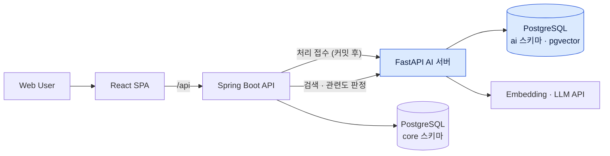

# PinLog — 개인 기여 기록

> 팀 프로젝트 전체 소개는 [대표 저장소 README](https://github.com/Team-PinLog/PinLog)에 있습니다.
> 이 문서는 그중 본인이 맡은 AI 서버와 계약 관리, 백엔드 AI 연동만 정리합니다.

## 1. Overview

| 항목 | 내용 |
|---|---|
| 프로젝트 | PinLog — 장소의 맥락을 기록하고 자연어로 다시 찾는 장소 아카이빙 서비스 |
| 기간 | 2026-07-21 ~ 2026-08-10 (21일) |
| 팀 | 6인 — FE 2 · BE 2 · Infra 1 · AI 1(본인). 08-04부터 AI 파트 2인 |
| 결과물 | Spring Boot API, React 웹, FastAPI AI 서버, k3s·Argo CD 배포 구성 (Team-PinLog 저장소 5개) |
| 본인 역할 | AI 파트 담당. 공용 API 명세(`docs`) 관리, 백엔드의 AI 연동 경로 구현 |
| 주요 기술 | Python 3.12, FastAPI, PostgreSQL·pgvector, asyncpg, pytest·Testcontainers, OpenAI·Gemini·Anthropic 호환 게이트웨이, Spring Boot(연동), GitHub Actions, SealedSecret |
| 기록 규모 | 작성 PR 128건(ai 91 · back 22 · docs 14 · infra 1). `ai` 저장소 PR 112건 중 91건이 본인 PR |

07-23부터 08-03까지는 AI 기능 코드를 혼자 작성했고, 08-04부터는 AI 파트가 2인이 됐습니다. 대화 이미지 기반 장소 제안 API와 결합 신뢰도 게이트 임계값 재측정은 다른 AI 파트원의 작업이라 이 문서에 포함하지 않습니다.

## 2. Project Architecture

파란색이 본인이 설계·구현한 영역입니다. Spring Boot API 중 AI 처리 접수·검색 연동·재스캔 Scheduler·문자열 병합은 본인이 `back` 저장소에 직접 구현했고, 나머지 백엔드·프론트엔드·인프라는 각 파트의 작업입니다.

AI 서버의 경계는 세 가지로 고정했습니다.

- `ai` 스키마만 쓰고 `core.*`는 조회하지 않습니다.
- 인증·소유권 판단·Core 상태 변경은 하지 않습니다. `userId`는 조회 필터로만 씁니다.
- 스키마 요구사항은 AI가 정의하고 Migration 실행은 백엔드가 합니다.

## 3. My Contributions

### 3.1 AI 처리 파이프라인과 상태 전이 — 직접 설계·구현

- **배경** Context 저장과 임베딩·키워드 판정을 분리해, 모델 호출이 느리거나 실패해도 기록 저장이 막히지 않아야 했습니다.
- **수행** `POST /internal/v1/context/process`가 202로 접수하고 백그라운드에서 처리합니다([ai#6](https://github.com/Team-PinLog/ai/pull/6)). 임베딩과 키워드는 각각 `PENDING → PROCESSING → COMPLETED / FAILED`로 독립 전이하고, 시작 전이는 조건부 UPDATE의 영향 행 수로 판정합니다. 외부 모델 호출은 트랜잭션 밖에서 하고, 결과 저장 직전에 `FOR UPDATE`로 다시 확인합니다. 키워드는 LLM이 자유 생성하지 않고 프리셋 후보 TOP-K 안에서만 고르게 했습니다.
- **결과** 중복 요청과 삭제 경합은 예외 없이 "영향 행 0"으로 끝나고, 임베딩만 완료된 상태에서는 키워드 단계부터 재개합니다.
- **근거** [context_processing.py](https://github.com/Team-PinLog/ai/blob/dev/app/service/context_processing.py) · [ai_state_repo.py](https://github.com/Team-PinLog/ai/blob/dev/app/repository/ai_state_repo.py) · [ai#6](https://github.com/Team-PinLog/ai/pull/6)

### 3.2 자연어 검색과 4신호 고도화 — 직접 설계·구현

- **배경** 의미 검색만으로는 「부캠」 같은 짧은 고유명사가 잡히지 않았습니다. 컷을 풀어도 8위였습니다.
- **수행** 기본 검색은 질의 1회 임베딩 → 정확 cosine → Record 단위 집계 → 컷 순서입니다([ai#5](https://github.com/Team-PinLog/ai/pull/5)). 컷은 절대 하한과 1위 대비 비율을 함께 걸고, 단어형 질의는 별도 하한으로 분기했습니다([ai#91](https://github.com/Team-PinLog/ai/pull/91)). 그 위에 질의 재작성·키워드 재정렬·문자열 병합(RRF)을 추가하고([ai#118](https://github.com/Team-PinLog/ai/pull/118) · [back#206](https://github.com/Team-PinLog/back/pull/206)), LLM 관련도 재판정을 네 번째 신호로 붙였습니다([ai#119](https://github.com/Team-PinLog/ai/pull/119)).
- **결과** 네 신호 모두 기본값 꺼짐 플래그 뒤에 두고, 꺼진 상태가 기존 동작과 같다는 것을 계약 테스트와 검증 게이트로 고정했습니다. 08-08 릴리스에서 운영 환경에 활성화했습니다([ai#123](https://github.com/Team-PinLog/ai/pull/123) · [infra#264](https://github.com/Team-PinLog/infra/pull/264)).

### 3.3 백엔드 AI 연동 — 파트 경계 너머 구현

- **배경** 백엔드 PR이 병합된 뒤에도 AI 처리 호출 경로가 비어 있었습니다.
- **책임** 순서 계약과 검증 방법을 티켓에 먼저 적고, 백엔드 파트가 착수하지 못한 연동을 `back` 저장소에 직접 구현했습니다.
- **수행** Context INSERT 후 커밋이 끝난 시점에만 AI 서버를 호출하도록 `@TransactionalEventListener(AFTER_COMMIT)`로 묶었습니다([back#82](https://github.com/Team-PinLog/back/pull/82)). 커밋 전에 호출하면 워커가 `PENDING` 행을 보지 못해 조용히 실패합니다. 검색 연동([back#98](https://github.com/Team-PinLog/back/pull/98))과 유실·정지된 처리를 다시 접수하는 재스캔 Scheduler([back#104](https://github.com/Team-PinLog/back/pull/104))도 구현했습니다.

### 3.4 오류 계약·운영 안전장치

- 오류를 재시도 가능(Transient)과 불가(Permanent) 두 종류로만 나누고, 검색 응답에서 500은 "우리 코드 결함"만 뜻하게 했습니다.
- 판정 LLM 호출에 3단 벤더 폴백 체인을 붙였습니다([ai#51](https://github.com/Team-PinLog/ai/pull/51)). 다음 벤더로는 Transient 오류만 넘어갑니다.
- 기동 시 설정 검사, 배포 직후 양방향 스모크, `/ready` 세 단계 배포 게이트를 만들었습니다([ai#33](https://github.com/Team-PinLog/ai/pull/33)). 비밀값은 값 소유자가 SealedSecret으로 암호화해 전달하도록 했습니다([ai#34](https://github.com/Team-PinLog/ai/pull/34)).

### 3.5 공용 명세와 파트 간 계약

- 공용 AI 설계를 `docs` 저장소의 단일 원본으로 정리했습니다([docs#2](https://github.com/Team-PinLog/docs/pull/2)).
- 계약이 바뀌면 관련 저장소를 한 티켓으로 묶어 함께 고쳤습니다. 검색 응답의 `keywordStatus`는 명세를 먼저 개정하고 구현을 뒤에 올려 2개 저장소 3개 PR로 반영했습니다([back#161](https://github.com/Team-PinLog/back/pull/161) · [docs#41](https://github.com/Team-PinLog/docs/pull/41) · [back#163](https://github.com/Team-PinLog/back/pull/163)).
- 타 파트 PR 18건에 리뷰 코멘트를 남겼습니다. 인프라가 연 dev 배포 승인 계약에는 배포를 막을 수 있는 결함 3건과 승인 항목 13개를 소스 기준으로 회신했습니다.

## 4. Engineering Decisions

### 임베딩 모델을 large로 바꾸지 않았다

- **문제** 짧은 질의 검색 실패를 임베딩 모델 교체로 풀 수 있는지 판단해야 했습니다.
- **검토** small·large와 장소명 결합 여부의 4조건을 실제 검색 경로로 측정했습니다([ai#54](https://github.com/Team-PinLog/ai/pull/54)).
- **결과** 종단 검증 질의 12건 중 1위 정답 수는 두 조건 모두 10건이었고, 틀린 질의만 달랐습니다. large는 벡터당 저장 크기가 정확히 2배였고 pgvector 인덱스 차원 상한도 남았습니다.
- **선택** large 채택을 보류하고, 실패 원인을 질의별로 분해한 뒤([ai#89](https://github.com/Team-PinLog/ai/pull/89)) 문자열 검색 병합으로 방향을 바꿨습니다.

### 바꾸지 않기로 한 결정도 측정으로 남긴다

- **문제** 판정 프롬프트 개정안, 판정 n회 다수결처럼 "좋아 보이는" 변경이 계속 제안됐습니다.
- **검토** 프롬프트 개정안 2종을 실데이터로 A/B 측정했습니다.
- **결과** 오분류 감소 폭이 같은 프롬프트를 다시 돌렸을 때의 변동보다 작았습니다. 다수결은 호출이 3~5배 늘어나는 대가에 비해 오분류 감소가 1행 미만이었습니다.
- **선택** 현행 프롬프트 유지, 다수결은 경로만 넣고 n=1 유지. 판단 근거와 측정 도구를 저장소에 남겼습니다([ai#72](https://github.com/Team-PinLog/ai/pull/72) · [ai#76](https://github.com/Team-PinLog/ai/pull/76)).

### 검색 신호는 기본 꺼짐과 검증 게이트 통과를 조건으로 켠다

- **문제** 검색 신호를 추가할 때마다 기존 결과가 흔들릴 위험이 있었습니다.
- **선택** 모든 신호를 기본 꺼짐 플래그 뒤에 두고, 백엔드와 AI 서버를 함께 띄워 사용자와 같은 경로(쿠키 인증·CSRF 포함)로 검증 게이트를 통과한 신호만 릴리스했습니다.
- **근거** [ai#118](https://github.com/Team-PinLog/ai/pull/118) · [ai#119](https://github.com/Team-PinLog/ai/pull/119) · [back#206](https://github.com/Team-PinLog/back/pull/206) · [run_gate.py](https://github.com/Team-PinLog/ai/blob/dev/tools/e2e/run_gate.py)

## 5. Troubleshooting

### DB 접속 실패가 503이 아니라 500으로 나갔다

- **증상** asyncpg 예외 분류 테스트는 모두 통과했는데, 실제 DB 접속 실패는 500으로 응답했습니다.
- **원인** 접속 실패는 asyncpg 예외가 아니라 `OSError` 계열이었고, 연결 획득(`pool.acquire()`)이 repository 밖에서 일어나 분류 지점을 지나지 않았습니다.
- **조치** 분류를 repository가 아니라 세션 경계에 걸고, SQLSTATE 군 단위로 Transient·Permanent를 나눴습니다.
- **재발 방지** 버전 의존 관계를 [test_db_error_classification.py](https://github.com/Team-PinLog/ai/blob/dev/tests/test_db_error_classification.py)로 고정했습니다.
- **기록** [트러블슈팅 문서](https://github.com/Team-PinLog/ai/blob/dev/docs/troubleshooting/2026-07-31-db-error-pitfalls.md)

### base 검사를 추가한 직후 base=main PR이 그대로 통과했다

- **증상** `main`을 base로 병합되어 `main`과 `dev` 내용이 어긋났습니다. CI에 base 검사를 넣었는데, 신설 직후 열린 `base=main` PR이 다시 통과했습니다.
- **원인** 병합 판정이 CI 초록과 병합 가능 상태만 봤고, 새 검사가 막으려던 대상을 정확히 덮지 못했습니다.
- **조치** `Validate PR base` 단계를 고치고 `main` 쪽에도 같은 검사를 올렸습니다([ai#63](https://github.com/Team-PinLog/ai/pull/63) · [ai#66](https://github.com/Team-PinLog/ai/pull/66)).
- **교훈** 검사가 통과했다는 사실을 그 검사가 대상을 막는다는 뜻으로 읽지 않고, 일부러 깨뜨려 막히는지 확인했습니다. 커버리지 게이트도 같은 방식(RED 드릴)으로 확인했습니다.

### 판정 호출 쿼터를 잘못 단정해 시딩이 15분 걸렸다

- **증상** 게이트웨이 쿼터를 "분당 2건"으로 보고 시딩 도구의 `--pace` 기본값을 25로 잡아, 시연 데이터 시딩이 15분 8초 걸렸습니다.
- **확인** 1초 간격 15회 호출과 동시 10건 호출을 다시 측정했고 모두 성공했습니다. 쿼터 값은 측정 시점과 경로에 따라 달라지는 값이었습니다.
- **조치** `--pace` 기본값을 1로 바꿔 소비 토큰은 같고 시간은 42초가 됐습니다([ai#49](https://github.com/Team-PinLog/ai/pull/49)).

## 6. Validation & Results

| 항목 | 결과 | 근거 |
|---|---|---|
| AI 서버 테스트 | 08-08 릴리스 시점 535 passed(parametrize 확장 포함 실행 케이스 기준), coverage line 94.68% · branch 84.05% | [ai#123](https://github.com/Team-PinLog/ai/pull/123) |
| 커버리지 게이트 | line·branch 각 80%를 병합 차단 조건으로 설정, 임계값 조작·측정 플래그 누락 시 실패하는지 RED 드릴로 확인 | [구현 기록](https://github.com/Team-PinLog/ai/blob/dev/docs/implements/2026-07-30-coverage-gate.md) |
| 검색 신호 | 4개 신호 모두 검증 게이트 통과 후 릴리스, 운영 환경에서 활성화 | [ai#118](https://github.com/Team-PinLog/ai/pull/118) · [ai#119](https://github.com/Team-PinLog/ai/pull/119) · [infra#264](https://github.com/Team-PinLog/infra/pull/264) |
| 릴리스 | dev → main 릴리스 (07-31 · 08-03 · 08-06 · 08-08) | [ai#123](https://github.com/Team-PinLog/ai/pull/123) |

## 7. Evidence

- 저장소: [Team-PinLog/ai](https://github.com/Team-PinLog/ai) · [Team-PinLog/back](https://github.com/Team-PinLog/back) · [Team-PinLog/docs](https://github.com/Team-PinLog/docs) · 대표 모노레포 [Team-PinLog/PinLog](https://github.com/Team-PinLog/PinLog)
- 명세: [ai/docs/spec](https://github.com/Team-PinLog/ai/tree/dev/docs/spec) · 구현 기록: [ai/docs/implements](https://github.com/Team-PinLog/ai/tree/dev/docs/implements) · 트러블슈팅: [ai/docs/troubleshooting](https://github.com/Team-PinLog/ai/tree/dev/docs/troubleshooting)
- 측정 도구: [ai/tools](https://github.com/Team-PinLog/ai/tree/dev/tools) (임베딩 격자, 임계값 격자, 검색 컷, 프롬프트 A/B, 다수결, 판정 모델 비교 등 11종)
- 핵심 소스: [search_service.py](https://github.com/Team-PinLog/ai/blob/dev/app/service/search_service.py) · [vendors.py](https://github.com/Team-PinLog/ai/blob/dev/app/client/vendors.py) · [db_errors.py](https://github.com/Team-PinLog/ai/blob/dev/app/core/db_errors.py) · [redact.py](https://github.com/Team-PinLog/ai/blob/dev/app/core/redact.py)

### 남아 있는 한계

- 검색 품질 판단은 소규모 종단 검증 질의(12건)와 시연 데이터 기준입니다. 실사용자 트래픽에서의 검색 품질은 측정하지 않았습니다.
- 임베딩 large 채택 여부는 표본 부족으로 보류한 상태로 프로젝트가 끝났습니다.
