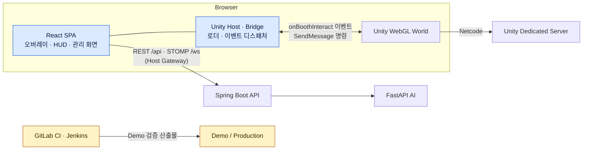

# SSAFESTA — 개인 기여 기록

> 팀 프로젝트 전체 소개는 [원본 저장소 README](https://github.com/mingleland/ssafesta)에 있습니다.
> 이 문서는 그중 본인이 맡은 영역과 직접 수행한 작업만 정리합니다. PR 번호는 원본 저장소로 이관된 GitLab MR 번호와 같습니다.

## 1. Overview

| 항목 | 내용 |
|---|---|
| 프로젝트 | SSAFESTA (팀 MingleLand) |
| 기간 | 2026-08-10 ~ 2026-09-22 (약 6주) |
| 팀 | 6인 — Unity/Game 리드(팀장), Backend, Infra, AI, Game Studio, Frontend Main(본인) |
| 목적 | 사용자가 가상 공간의 부스를 임대하고 프로젝트·설문·AI 직원을 등록해 방문객에게 여는 메타버스 전시 서비스 |
| 결과물 | React·Spring·Unity WebGL·Unity Dedicated Server·FastAPI로 구성된 모노레포, Demo·Production 배포 |
| 공식 역할 | Frontend Main Owner / Platform & Booth |
| 실제 수행 범위 | FE 공통 플랫폼 → Unity·Web 통합 → 통합 검증과 demo 장애 진단 → 후반 Production 승격·CI 개선 |
| 주요 기술 | React 19, TypeScript, Vite, Vitest, TanStack Query, Unity WebGL Bridge, STOMP over WebSocket, Docker, nginx, GitLab CI, Jenkins |
| 기록 규모 | 작성 MR 390건(merged 370) · 담당 Jira 142건. 2026-09-22 기준 GitLab·Jira 전수 집계 |

공식 역할은 프로젝트 내내 Frontend Main 하나였습니다. 역할 변경 기록은 없고, 통합과 배포 단계에서 막힌 문제를 해결하면서 실제 작업 범위가 넓어졌습니다. 팀장과 규약 개정 권한은 Unity/Game 리드에게 있었습니다.

## 2. Project Architecture

파란색은 처음부터 맡은 영역, 노란색은 후반에 직접 개입한 영역입니다. Spring API, Unity 월드와 게임 서버, AI 서버, 인프라 구성은 각 담당자의 영역입니다.

| 구분 | 영역 |
|---|---|
| 직접 설계·구현 | FE 공통 구조(라우팅·API Client·오버레이), Unity Host·Gateway, 부스 관리·임대 화면, 월드 채팅 FE, 관리자 콘솔 FE, 전역 오류 처리, FE Docker 이미지·nginx·runtime-config |
| 공동 확정 | Unity↔React 이벤트 계약, 부스 Layout JSON 계약(spec 005) |
| 타 파트 영역 직접 구현 | Unity 이벤트 송신부 C# 코드 일부, 후반 BE·AI 계약 불일치 수정, Production 승격 스크립트·Jenkins 구성 |
| 통합·검증 | 로컬 BE·게임 서버·FE 동시 기동 전체 회귀, Game Studio E2E·테스트 안정화 |
| 진단만 수행 | Unity 로딩 병목 원인, OAuth 401 원인, demo 배포본 노후 판정 |
| 맡지 않은 영역 | Unity 런타임·씬, Spring API 본 구현, Game Studio 코드, AI 채팅 화면, CI 게이트 활성화·Cloudflare·EC2 운영 |

## 3. My Contributions

### 3.1 FE 공통 플랫폼과 Unity Host — 직접 설계·구현

- **배경** React 화면과 Unity WebGL 월드가 한 브라우저 안에서 입력·상태·인증을 나눠 가져야 했습니다.
- **책임** FE 공통 구조와 Unity 연결 계층의 설계·구현.
- **수행** `unity/bridge/events.ts`의 discriminated union, `shared/api/client`, 오버레이 타입을 먼저 확정하고 Unity Host(로더·세션 관리)와 Bridge → Dispatcher → OverlayHost 경로를 연결했습니다. 이후 월드를 중심에 둔 화면 흐름으로 재구성하고([#240](https://github.com/mingleland/ssafesta/pull/240)), React와 Unity가 실제 Backend 주소를 몰라도 같은 출처 `/api`로 통신하도록 Host Gateway를 만들었습니다([#537](https://github.com/mingleland/ssafesta/pull/537)).
- **결과** 이벤트 계약 구조가 프로젝트 끝까지 유지됐습니다. Unity C# 변경 없이 Gateway를 적용했습니다.
- **근거** [events.ts](https://github.com/mingleland/ssafesta/blob/develop/festa-frontend/src/unity/bridge/events.ts) · [UnityHost.tsx](https://github.com/mingleland/ssafesta/blob/develop/festa-frontend/src/unity/host/UnityHost.tsx) · [#240](https://github.com/mingleland/ssafesta/pull/240) · [#537](https://github.com/mingleland/ssafesta/pull/537)

### 3.2 Unity·Web 이벤트 계약 — 공동 확정과 경계 너머 구현

- **배경** 월드의 오브젝트를 눌러도 React 화면이 열리지 않는 구간이 남아 있었습니다. 화면과 API는 대부분 있었고, 그 사이 이벤트가 없었습니다.
- **책임** 계약은 Unity 담당과 공동 확정. Unity·FE만으로 닫히는 4건은 Unity 송신부까지 본인이 작성했습니다(Jira 담당과 런타임 검증은 Unity 담당).
- **수행** 프로젝트·설문·관리 NPC 상호작용 이벤트를 C# 송신부와 FE 수신부 양쪽에 구현했습니다([#250](https://github.com/mingleland/ssafesta/pull/250)). ESC 처리와 입력 잠금은 Unity가 UI 상태를 알려 주고 FE가 명시 명령을 보내는 채널로 정리했습니다([#572](https://github.com/mingleland/ssafesta/pull/572) · [#580](https://github.com/mingleland/ssafesta/pull/580)).
- **결과** develop 반영. Unity Editor가 없는 환경에서 작성해 씬 배치와 런타임 검증은 Unity 담당의 몫으로 남겼습니다.

### 3.3 통합 검증과 장애 진단

- **배경** 각 파트가 개별 테스트는 통과했지만 BE·게임 서버·FE를 함께 띄운 경로는 검증된 적이 없었습니다.
- **수행** 로컬에서 BE·게임 서버·FE를 함께 띄워 게스트·회원 두 경로를 관통하고 FE 전체 회귀를 기록했습니다([회귀 기록](https://github.com/mingleland/ssafesta/blob/develop/docs/LJH/verify/fe-full-regression-0908.md)). demo 화면이 검게 뜨는 문제는 번들 해시를 비교해 코드가 아니라 배포본이 낡은 것임을 분리하고 종결 조건을 정의했습니다. 복구 실행은 Infra 담당이 했습니다.
- **결과** 회귀 결과는 PASS 79 · FAIL 5 · BLOCKED 4 · NOT_EXECUTED 2이며, 막힌 항목마다 재현 조건과 막힌 지점을 남겼습니다.

### 3.4 FE 배포 구성과 후반 Production 승격 — 운영·배포

- **배경** Infra compose가 FE 이미지를 기다리는데 Dockerfile이 없었고(08-26), 9월 18일에는 demo 장애가 하루 5건 발생했습니다.
- **책임** FE 이미지는 처음부터 FE 소관으로 맡았습니다. Production 승격 작업은 Infra 담당 Jira 티켓 아래에서 본인이 직접 수행했습니다.
- **수행** FE Dockerfile·nginx·runtime-config 주입 경로를 만들었습니다([#545](https://github.com/mingleland/ssafesta/pull/545)). 9월 19~22일에는 Production 환경과 승격 경로를 새로 만들고([#1217](https://github.com/mingleland/ssafesta/pull/1217)), CI 구조와 성능을 고쳤습니다([#1233](https://github.com/mingleland/ssafesta/pull/1233) · [#1240](https://github.com/mingleland/ssafesta/pull/1240) · [#1241](https://github.com/mingleland/ssafesta/pull/1241)).
- **결과** main 승격 MR 11건 merged. Production 검증에서 발견된 결함은 rollback 후 재승격으로 처리했습니다. 이 기간에도 Infra 담당이 같은 티켓에서 병행 작업을 했고, 최종 운영 책임은 Infra 담당에게 있었습니다.

### 3.5 협업과 계약 조정

- 한 사실이 여러 spec 파일에 복제되던 구조를 "정본 한 곳 + 참조" 규칙으로 바꾸자고 제안했고, 리드가 채택했습니다.
- 다른 파트가 읽고 답해야 하는 요청이 개인 문서와 Jira 코멘트에 묻히던 문제를 정리해 GitLab Issue를 요청 경로로 쓰기 시작했습니다.
- 지정 리뷰어로 들어간 타 파트 MR 12건 중 11건에 리뷰 코멘트를 남겼고, 그중 4건은 결함 지적 후 수정 확인을 거쳐 승인했습니다.

## 4. Engineering Decisions

### ESC·입력 소유권을 Unity 상태 snapshot과 명시 명령으로 분리

- **문제** ESC를 한 번 눌러도 닫히지 않거나, 오버레이를 닫아도 Unity 카메라 초점이 남아 이동 입력이 막혔습니다.
- **원인** FE의 ESC 판정이 FE store만 보고 Unity 쪽 초점 상태를 몰랐습니다. 여는 경로는 Unity, 닫는 경로는 FE여서 비대칭이었습니다.
- **검토** 이벤트 전파 차단 같은 FE 단독 수정 후보와, 상태를 한쪽이 소유하게 하는 방식을 비교했습니다.
- **선택** Unity가 `worldUiState`(focus·minigame)를 알려 주고 FE는 `RequestExitWorldUi` 명령을 보냅니다. Unity의 입력 처리 코드는 FE가 건드리지 않습니다.
- **검증** 관련 단위 테스트 22건을 추가했습니다. 근거: [#572](https://github.com/mingleland/ssafesta/pull/572) · [#580](https://github.com/mingleland/ssafesta/pull/580)

### Demo에서 검증한 산출물을 그대로 Production에 올린다

- **문제** Production 환경이 없었고, 9월 18일 장애로 "저장소의 설정이 실제로 실행된 적이 없다"는 점이 드러났습니다.
- **선택** develop → main을 non-squash로 승격하고, Demo 승인 영수증(receipt)을 Production의 유일한 입력으로 삼았습니다. 승격 중 Docker·Unity·WebGL 재빌드는 하지 않습니다. 상태는 candidate / current / known-good / previous로 나누고, 사람 검증 전에는 known-good을 바꾸지 않습니다.
- **구현 중 정정** Docker runtime image ID와 `docker save` archive의 digest가 같다고 가정한 첫 구현이 identity 검증에서 실패했습니다. 두 값을 분리하고 archive SHA-256을 전송 identity로 삼았습니다.
- **근거** [#1217](https://github.com/mingleland/ssafesta/pull/1217) · [#1219](https://github.com/mingleland/ssafesta/pull/1219) · [#1235](https://github.com/mingleland/ssafesta/pull/1235)

### Jenkins에서 Unity Editor를 돌리지 않는다

- **문제** Unity 빌드가 라이선스 오류로 실패했습니다. 라이선스가 컨테이너 hostname·machine id에 묶여 에이전트를 다시 만들 때마다 무효가 됐습니다.
- **검토** 같은 날 오전에 hostname 고정과 사전 검사 경로를 만들었지만 재생성 뒤에도 라이선스를 찾지 못했습니다. 재활성화는 Unity 계정 소유자만 할 수 있었습니다.
- **선택** Jenkins는 Unity Release Bundle이 올라온 이후 단계만 자동화합니다(Consumer-only). 오전에 만든 경로는 모두 제거했습니다.
- **근거** [#1237](https://github.com/mingleland/ssafesta/pull/1237) · [#1240](https://github.com/mingleland/ssafesta/pull/1240)

## 5. Troubleshooting

### 월드 진입 지연의 원인이 다운로드가 아니었다

- **증상** 회원으로 월드에 들어가면 진입이 30초 넘게 걸렸습니다. 처음에는 142MB Unity 데이터 다운로드를 원인으로 판단해 이슈를 올렸습니다.
- **확인 과정** 회원과 게스트를 같은 지표로 다시 측정했습니다. 메인 씬 로드는 둘 다 2~4초였고, 차이는 진입 게이트 개방 시간(48.2s vs 0.2s)에서 났습니다.
- **최종 원인** Unity `WorldEntryGate`가 "40ms 이내 프레임 12연속"을 기다리는데, 회원 세션에서는 프레임 끊김이 계속돼 게이트가 열리지 않았습니다.
- **조치** 기존 이슈에 원인 정정을 게시하고 게임 파트의 판단을 요청했습니다. Unity 코드는 게임 파트 소관이라 직접 수정하지 않았습니다.
- **남은 한계** 프레임 끊김의 유력 후보(다른 플레이어 아바타 동기 조립)까지만 좁혔고, 최종 수정은 게임 파트에 남았습니다.

### 월드 채팅 소켓이 유휴 128초에 끊겼다

- **증상** 아무 입력이 없으면 채팅 연결이 끊겼습니다.
- **확인 과정** 처음에는 허용 목록 밖 SEND가 세션을 끊는다고 가정했지만, 측정값(128.343s · 128.488s)이 그 가설과 맞지 않아 철회했습니다. Cloudflare(100s)·nginx(180s) 제한 시간과도 맞지 않았습니다.
- **최종 원인** STOMP heartbeat가 없었습니다. 공용 transport를 직접 구현하면서 heartbeat 프레임을 빠뜨렸습니다.
- **조치** FE에 heart-beat 설정을 넣고 서버 설정과 짝을 맞춰야 한다는 조건을 남겼습니다([#1017](https://github.com/mingleland/ssafesta/pull/1017)). 끊김 원인을 콘솔과 진단값에 남기는 로깅도 추가했습니다([#878](https://github.com/mingleland/ssafesta/pull/878)).

### Production에서만 AI 도우미가 두 명 섰다

- **증상** Production 사람 검증에서 부스마다 AI NPC가 두 기씩 나타났습니다. Demo에서는 재현되지 않았습니다.
- **1차 대응과 정정** 재발 경로를 막는다며 게시 바인딩 플래그를 껐지만([#1228](https://github.com/mingleland/ssafesta/pull/1228)), 그러면 최초 게시에서 AI 직원 설정이 아예 빠진다는 것을 같은 날 발견해 되돌렸습니다([#1230](https://github.com/mingleland/ssafesta/pull/1230)).
- **최종 원인** 게시본의 AI 오브젝트를 두 경로가 함께 생성했고, 이를 막는 Unity 가드가 Production에 배포된 WebGL 산출물에는 들어 있지 않았습니다.
- **조치** 가드가 포함된 WebGL로 교체하고, 유지보수 상태로 rollback한 뒤 새 영수증으로 재승격했습니다.
- **재발 방지** 가드 포함 여부를 커밋이 아니라 배포 산출물에서 확인합니다.

## 6. Validation & Results

| 항목 | 결과 | 근거 |
|---|---|---|
| FE 전체 회귀 (2026-09-08) | PASS 79 · FAIL 5 · BLOCKED 4 · NOT_EXECUTED 2 | [회귀 기록](https://github.com/mingleland/ssafesta/blob/develop/docs/LJH/verify/fe-full-regression-0908.md) |
| Unity 정적 자산 캐시 (2026-09-18 확인) | `.data` 29.6s → 4.27s. FE nginx 캐시 정책(본인)과 Cloudflare Cache Rule(Infra 담당)을 함께 적용한 결과 | [#1079](https://github.com/mingleland/ssafesta/pull/1079) |
| CI 실행 시간 | CI 설정만 바꾼 MR 12분 → 35초, Testcontainers 정리 누락 해소 | [#1241](https://github.com/mingleland/ssafesta/pull/1241) · [#1242](https://github.com/mingleland/ssafesta/pull/1242) |
| Production 승격 | main 승격 MR 11건 merged. 사람 검증에서 발견한 결함을 rollback 후 재승격으로 처리 | [#1235](https://github.com/mingleland/ssafesta/pull/1235) · [#1296](https://github.com/mingleland/ssafesta/pull/1296) |

## 7. Evidence

- 원본 저장소: [mingleland/ssafesta](https://github.com/mingleland/ssafesta) (GitLab MR·Jira·초기 GitHub 이력 통합 보존본)
- FE 구조: [events.ts](https://github.com/mingleland/ssafesta/blob/develop/festa-frontend/src/unity/bridge/events.ts) · [UnityHost.tsx](https://github.com/mingleland/ssafesta/blob/develop/festa-frontend/src/unity/host/UnityHost.tsx) · [realtimeClient.ts](https://github.com/mingleland/ssafesta/blob/develop/festa-frontend/src/shared/realtime/realtimeClient.ts) · [RootFatalErrorBoundary.tsx](https://github.com/mingleland/ssafesta/blob/develop/festa-frontend/src/app/RootFatalErrorBoundary.tsx)
- FE 배포: [Dockerfile](https://github.com/mingleland/ssafesta/blob/develop/festa-frontend/Dockerfile) · [nginx.conf](https://github.com/mingleland/ssafesta/blob/develop/festa-frontend/docker/nginx.conf)
- 주요 PR: [#240](https://github.com/mingleland/ssafesta/pull/240) 월드 중심 화면 재구성 · [#250](https://github.com/mingleland/ssafesta/pull/250) Unity·FE 상호작용 이벤트 · [#537](https://github.com/mingleland/ssafesta/pull/537) Host Gateway · [#834](https://github.com/mingleland/ssafesta/pull/834) 월드 채팅 · [#1317](https://github.com/mingleland/ssafesta/pull/1317) 오류 처리 3계층 · [#1217](https://github.com/mingleland/ssafesta/pull/1217) Production 승격 runtime · [#1240](https://github.com/mingleland/ssafesta/pull/1240) Consumer-only · [#1294](https://github.com/mingleland/ssafesta/pull/1294) AI 계약 거절 분류
- 검증 기록: [docs/LJH/verify](https://github.com/mingleland/ssafesta/tree/develop/docs/LJH/verify)

### 남아 있는 한계

- Unity 송신부 C# 코드는 Unity Editor 없이 작성했고, 런타임 검증은 Unity 담당에게 남았습니다.
- 부스 편집기(Booth Studio)는 2D 편집기와 2.5D 에셋 파이프라인까지 구현했지만, 9월 16일 사용자 진입이 폐기되어 최종 제품에서는 게시 흐름만 남았습니다.
- 월드 진입 지연의 근본 수정은 Unity 쪽 작업이라 원인 특정까지만 수행했습니다.
